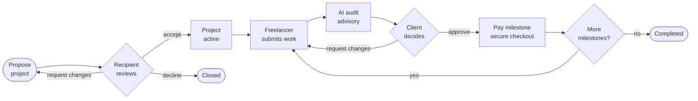
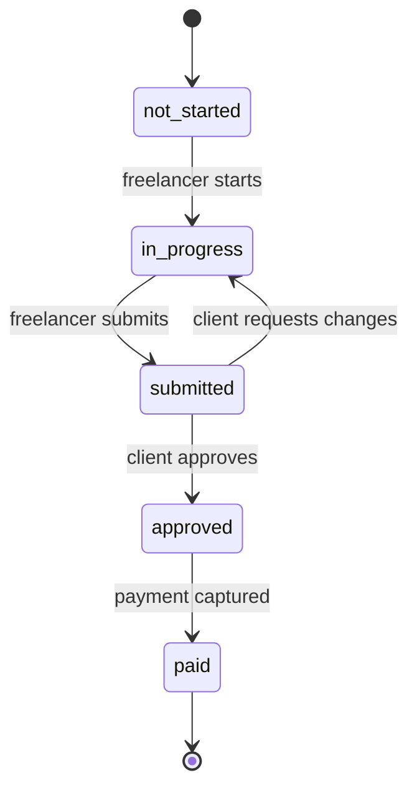
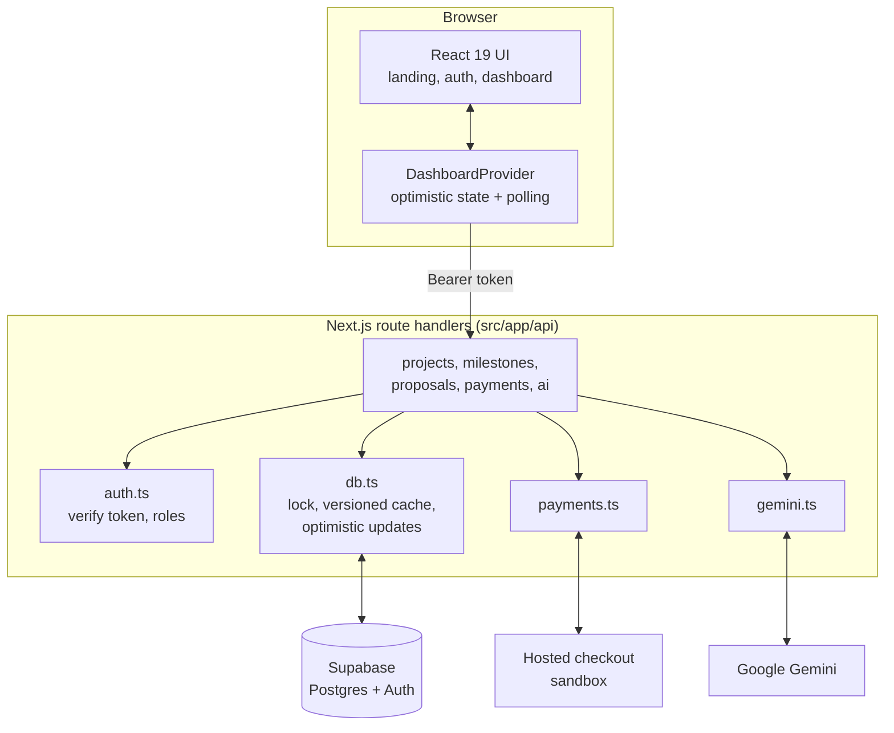

<div align="center">


# PerMile

### Work completed. Progress verified. Payments made with confidence.

**Milestone-based freelance contracts, AI-checked deliveries, and pay-as-you-approve payments.**

<br/>


[The problem](#-the-problem) · [How it works](#-how-it-works) · [Features](#-features) · [Architecture](#-architecture) · [Security](#-security-model) · [Get started](#-get-started) · [API](#-api-reference)

</div>

---

## 🎯 The problem

Freelance work runs on trust, and trust breaks in both directions.

| Without PerMile | With PerMile |
| --- | --- |
| Clients pay upfront and hope the work arrives | Clients pay **one verified milestone at a time** |
| Freelancers deliver, then chase the payment | Freelancers see exactly what has to be met, and get paid on approval |
| "Is this what we agreed?" arguments | Every milestone has written **acceptance criteria** that an AI checks the delivery against |
| No record of who did what | Every action lands in an **activity log and a payment ledger** |

> A client and a freelancer agree a project split into milestones, each with a price and acceptance criteria.
> The freelancer submits work, Gemini reviews it against the criteria (advisory only), the client approves,
> and the payment for that milestone goes through the checkout. Then the next milestone starts.

---

## 🔄 How it works



### Milestone life cycle

The server enforces this order. Out-of-order actions are rejected, so a paid milestone can never be re-opened or paid twice.



### Who can do what

| Action | Client | Freelancer |
| --- | :---: | :---: |
| Propose a project / share an invite link | ✅ | ✅ |
| Accept, decline, or request changes on a proposal | recipient only | recipient only |
| Withdraw or revise a proposal | proposer only | proposer only |
| Start work, submit deliverables | ❌ | ✅ |
| Run or read the AI audit | ✅ | ✅ |
| Approve or request changes on a milestone | ✅ | ❌ |
| Pay a milestone | ✅ | ❌ |

> One account owns **both** a client ID (`CL-XXXXXX`) and a freelancer ID (`FL-XXXXXX`) built from a shared base code, so any account can act on either side.
> A request can even be sent from your client ID to your **own** freelancer ID (and back), and every step above works between your two roles.

---

## ✨ Features

<table>
<tr>
<td width="50%" valign="top">

### 🤝 Contracts and proposals
- Direct proposals by `CL-` / `FL-` ID, or **private share links** (email, WhatsApp, copy)
- Accept, request changes, decline, withdraw, revise and resubmit
- Requests to **your own other role** are supported
- Active, Completed and Archived project views

</td>
<td width="50%" valign="top">

### 🧠 AI delivery review
- Gemini checks submitted links, notes and files against each acceptance criterion
- Evidence-based findings, missing deliverables and suggested revisions
- **Advisory only.** The client always decides
- Honest fallback if the AI is unavailable. It never claims a requirement is "met"

</td>
</tr>
<tr>
<td width="50%" valign="top">

### 💳 Payments
- Server-created orders priced from the contract, never from the browser
- The order is inspected before capture (id, amount, currency, status)
- Idempotent capture and recovery of already-captured orders
- Official one-page **invoice** for every paid milestone

</td>
<td width="50%" valign="top">

### 🎨 Experience
- Animated **web threads** landing background with light and dark themes
- Interactive 3D **milestone wheel** and budget calculator
- Live dashboard, notifications drawer, optimistic UI with rollback
- Responsive from phone to desktop

</td>
</tr>
</table>

---

## 🧩 Architecture



### Tech stack

| Layer | Technology |
| --- | --- |
| Frontend | Next.js 16 (App Router), React 19, TypeScript, Tailwind CSS v4, lucide icons |
| Landing visuals | WebGL web threads, CSS 3D milestone wheel, scroll-reveal animations |
| Backend | Next.js route handlers, server-only modules in `src/server` |
| Database and auth | Supabase (PostgreSQL, Auth, row-level security migrations) |
| AI | Google Gemini REST API with a four-model fallback chain |
| Payments | Hosted checkout (Orders v2 style create and capture), sandbox by default |

---

## 🔐 Security model

- **Identity comes only from a verified Supabase access token.** The server never trusts a user id, email or role sent in a body, query string or header.
- **Role checks are derived from the stored contract**, not from the request. Only the client approves and pays, only the freelancer submits, and only the recipient accepts a proposal.
- **Non-participants get a 404**, so project ids can't be probed.
- **Payment amounts always come from the contract.** The server inspects an order before capturing it, and rejects a wrong, underpriced or foreign order before any money moves.
- **Edits are whitelisted.** A project `PATCH` can change title, description, category, deadline and archive or restore. It can never change money, ids, participants or status to completed.
- **Hardened inputs:** URL and upload validation with size caps, signup rate limiting, escaped lookups, and masked emails in the directory.

---

## ⚡ Performance and reliability

Under load the dashboard used to hammer the database with full-project downloads. Now:

| Technique | What it does |
| --- | --- |
| **Version-only polling** | The browser asks "has anything changed?" about every 15 seconds and downloads projects only when the version differs |
| **Smart polling** | Never overlaps, pauses when the tab is hidden, and backs off up to 120 seconds on errors |
| **Versioned read cache** | The server keeps an index of `id + updated_at` and downloads only changed rows, in small parallel batches |
| **Shared queries** | Identical simultaneous requests share one database query |
| **Slim rows** | Stored projects no longer duplicate milestones, the activity log or attachment images |
| **30-second DB timeout** | Requests fail fast instead of hanging for minutes |
| **Optimistic concurrency** | Writes check `updated_at`, retry on conflict, and run under a per-project lock |
| **Double-click guards** | Approve, submit, accept, reject and create ignore repeated clicks while saving |
| **Live pop-ups** | Modals always show the current project, never a stale copy |

---

## 🚀 Get started

**Requirements:** Node.js 20+, a Supabase project, a Gemini API key, and sandbox credentials for the payment checkout.

```bash
git clone https://github.com/prakharagarwal-07/SatHack-2026.git
cd SatHack-2026
npm install
cp .env.example .env.local     # then fill in your keys
npm run dev                    # http://localhost:3000
```

### Database setup

Run the SQL files in `supabase/` in this order:

1. `schema.sql`
2. `migrations/002_multiuser_architecture.sql`
3. `migrations/003_shared_base_code.sql`
4. `migrations/004_strict_participant_rls.sql`
5. `migrations/005_sync_schema_with_app.sql` *(aligns the schema with what the app writes, safe to run repeatedly)*

### Environment variables

Copy `.env.example` to `.env.local`. Never commit real keys.

| Variable | Scope | Purpose |
| --- | --- | --- |
| `NEXT_PUBLIC_SUPABASE_URL` | browser + server | Supabase project URL |
| `NEXT_PUBLIC_SUPABASE_ANON_KEY` | browser + server | Supabase public key |
| `SUPABASE_SERVICE_ROLE_KEY` | **server only** | Verifies sessions and writes data. Never expose it |
| `GEMINI_API_KEY` | server only | AI audits and invoices |
| `NEXT_PUBLIC_APP_URL` | browser + server | Public app URL, used for checkout return links |
| Payment gateway keys | server (+ one public id) | Sandbox credentials. See `.env.example` for the exact names |
| `NEXT_PUBLIC_DEMO_NAME`, `_EMAIL`, `_PASSWORD` | browser | *Optional.* One-click demo account on the sign-in page. Leave empty to hide it |

> ⚠️ The demo variables are bundled into browser JavaScript. Use a throwaway account with no real data.

### Scripts

| Command | What it does |
| --- | --- |
| `npm run dev` | Start the development server |
| `npm run build` | Production build |
| `npm run start` | Run the production build |
| `npm run lint` | Run ESLint |

---

## 📡 API reference

Every route below requires a signed-in user (`Authorization: Bearer <access token>`) unless noted.

| Method | Route | Purpose |
| --- | --- | --- |
| `GET` | `/api/projects` | The caller's projects. `?versionOnly=1` returns just a change version |
| `POST` | `/api/projects` | Create a proposal, share link or draft |
| `GET` `PATCH` | `/api/projects/[id]` | Read a project, or edit its descriptive fields |
| `POST` | `/api/projects/[id]/proposals` | `accept`, `request_changes`, `reject`, `withdraw`, `resubmit` |
| `POST` | `/api/milestones` | Add a milestone |
| `PATCH` | `/api/milestones/[id]` | Edit a milestone that is not yet approved |
| `POST` | `/api/milestones/[id]/start` | Freelancer starts work |
| `POST` | `/api/milestones/[id]/submit` | Freelancer submits deliverables and runs the AI audit |
| `POST` | `/api/milestones/[id]/review` | Client approves or requests changes |
| `POST` | `/api/payments/create-order` | Create a checkout order from the contract |
| `POST` | `/api/payments/capture-order` | Verify and capture the approved order |
| `POST` | `/api/ai/verify-milestone` | Re-run the AI audit on the stored submission |
| `POST` | `/api/ai/generate-invoice` | Build the invoice for a paid milestone |
| `GET` `POST` | `/api/invitations/[token]` | View (public) or accept or revoke a share link |
| `GET` | `/api/users/lookup` | Look up a counterparty by ID, or list the directory |
| `GET` `POST` `PATCH` | `/api/notifications` | List, create (self only), mark read |
| `GET` | `/api/transactions` | The caller's payment ledger |
| `POST` | `/api/auth/signup` | Create an account (rate limited) |
| `GET` | `/api/health` | Real database probe. Public, no counts exposed |

---

## 🗂️ Project structure

```
.
├── src
│   ├── app
│   │   ├── page.tsx              # landing page
│   │   ├── auth/                 # sign in / sign up
│   │   ├── dashboard/            # workspace
│   │   ├── invite/[token]/       # share-link page
│   │   └── api/                  # route handlers (see API reference)
│   ├── server                    # server-only code
│   │   ├── auth.ts               # token verification, role checks
│   │   ├── db.ts                 # data layer, lock, versioned cache
│   │   ├── identity.ts           # CL-/FL- ID resolution
│   │   ├── payments.ts           # checkout orders and capture
│   │   ├── gemini.ts             # AI audits and invoices
│   │   └── supabase.ts, errors.ts, ids.ts
│   ├── lib                       # shared types, dashboard store, authFetch
│   └── components                # landing UI and dashboard/ components
├── supabase                      # schema.sql and migrations
├── public                        # logos and icons
└── scripts                       # older ad-hoc scripts (obsolete, see notes)
```

---

## ✅ Testing and quality

- **155 server checks** run the real compiled route handlers against an in-memory fake Supabase and a fake payment gateway. They cover:
  - unauthenticated and spoofed requests
  - role rules and cross-user privacy
  - payment edge cases (underpriced, foreign, replayed and recovered captures)
  - concurrent edits and version conflicts
  - polling cost and the self-addressed request flow
- `tsc --noEmit` is clean.
- The AI path was verified live against Gemini (audit and invoice).

---

## 📝 Notes and known limits

- **Sandbox only.** Payments run against a sandbox. There is no real money movement, and no holding account: the flow is *approve, then pay*.
- **Currencies:** USD, EUR, GBP, CAD and AUD can be paid. A contract in another currency (for example INR) can be created but must be changed before payment.
- **Uploads:** 5 MB per file and 8 MB per submission.
- **AI timing:** a real audit or invoice takes around 15 seconds. If Gemini is slow or down, a clearly labelled basic check is shown instead.
- **Forgot password** is not available yet.
- **Scaling:** the per-project lock and read cache live in server memory. Several server instances would need a shared lock and cache.
- **Demo credentials** are bundled into the browser build, and so should be rotated before any public launch.
- The `scripts/` folder holds older tests written before token authentication. They send identity in the request and need updating before use.

---

<div align="center">

### Built at SatHack 2026

**Work completed. Progress verified. Payments made with confidence.**

MIT licensed · see [LICENSE](LICENSE)

</div>
